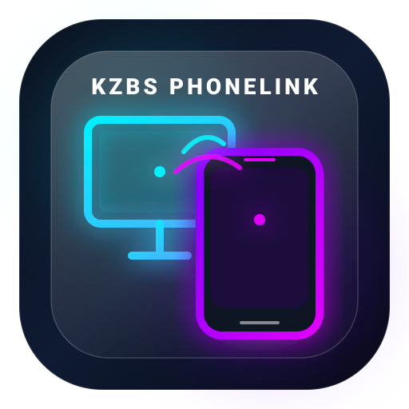

# 📱💻 KZBS PhoneLink v1.0.0
### Telefon & Bilgisayar Akıllı Köprü ve Yönetim Sistemi



**KZBS PhoneLink**, Android telefonunuz ile Windows bilgisayarınız arasında tam teşekküllü, kesintisiz ve sıfır zahmetli bir bağlantı kuran yeni nesil bir masaüstü ve mobil yönetim paketidir.

---

## ✨ Öne Çıkan Özellikler

### 1. 💬 Mesajlar (SMS) & Anında 2FA Doğrulama Kodları
* Telefondaki tüm SMS konuşmalarını PC ekranında görüntüleyin.
* **Akıllı 2FA / Banka Kodu Algılama:** Banka veya sitelerden gelen SMS onay kodları otomatik algılanır ve **"Kodu Kopyala 📋"** butonu sunulur. Telefona dokunmadan tek tıkla kopyalayıp tarayıcınıza yapıştırabilirsiniz.
* Bilgisayar klavyesinden doğrudan SMS yazıp gönderebilme.

### 2. 📞 Telefon, Tuş Takımı & Arama Yönetimi
* **Apple / iOS Liquid Glass Tuş Takımı:** Gerçekçi DTMF çift tonlu ses efektleri (Web Audio API) ve yuvarlak cam butonlar.
* **PC'den Arama Başlatma:** Numarayı yazıp *"Ara"* dediğinizde telefonunuz arka planda aramayı başlatır.
* **Bluetooth Hands-Free Ses:** Bilgisayar mikrofonunuzdan konuşup, bilgisayar hoparlöründen / kulaklığınızdan dinleyin.

### 3. 📱 Özel Arama Ekranı (In-Call HUD)
Görüşme başladığında bilgisayarınızda açılan özel panel:
* Canlı konuşma süresi sayacı (`00:01, 00:02...`)
* 🔴 **Aramayı Sonlandır**
* ➕ **Arama Ekle (Konferans)**
* 🔢 **Görüşme İçi Tuşlama** (Müşteri hizmetlerinde 1'e, 2'ye basabilmek için)
* 🎙️ **Sessize Al (Mute) & Hoparlör Kontrolleri**

### 4. 👥 Kişiler (Rehber) & Son Aramalar (Geçmiş)
* Telefondaki tüm rehberi arama ve filtreleme imkanı.
* Kişinin yanındaki butonla tek tıkla doğrudan **"Ara"** veya **"SMS Gönder"**.
* Gelen, giden ve cevapsız aramaları süreleriyle listeleyen geçmiş sekmesi.

### 5. ⚡ Zero-Touch (Sıfır Zahmet) Otomatik Bağlantı
* Her gün QR kod okutmak veya bağlan butonuna basmak yok!
* Yerel ağdaki UDP Broadcast keşfi sayesinde, bilgisayar uygulamasını açtığınız an cepteki veya şarjdaki telefonla **1 saniye içinde kendiliğinden eşleşir**.

---

## 🎨 Tasarım: iOS Liquid Glass
* Yarı saydam buzlu cam paneller (`backdrop-filter: blur(35px) saturate(190%)`)
* Ekranın altında akıcı yana kayma animasyonuna sahip **Yüzen Cam Dock (Floating Dock Pill)**
* Dinamik neon ortam ışıkları (Ambient Liquid Glow)

---

## 🚀 Kurulum ve Başlatma

### Bilgisayar (PC) Kurulumu:
1. `pc-app/setup/install.bat` dosyasına çift tıklayın.
2. Kurulum sihirbazı gerekli paketleri kontrol edecek ve masaüstünüze **"KZBS PhoneLink"** kısayolunu oluşturacaktır.
3. Masaüstündeki simgeye çift tıklayarak uygulamayı başlatabilirsiniz.
4. Doğrudan tarayıcıdan açmak isterseniz: `http://localhost:4955`

### Android Telefon Kurulumu:
1. `android-app` klasöründeki projeyi Android Studio ile açıp telefonunuza yükleyin (veya derlenen APK dosyasını kurun).
2. Uygulamayı ilk açışta istenen standart izinleri (SMS, Arama, Rehber) onaylayın.
3. Uygulama arka planda bir servis olarak sessizce çalışacak ve telefonunuz açıldığında otomatik olarak devreye girecektir.

---

## 📁 Proje Dizin Yapısı

```
phone-desktop-link/
├── pc-app/                      # Bilgisayar Uygulaması
│   ├── server.js                # Express & WebSocket Sunucusu + UDP Discovery
│   ├── package.json             # Bağımlılıklar
│   ├── start.bat                # Hızlı Başlatıcı
│   ├── setup/
│   │   └── install.bat          # Windows Masaüstü Kısayol Kurucusu
│   └── public/
│       ├── index.html           # Liquid Glass Master Arayüzü
│       ├── css/style.css        # iOS Cam Tasarım & Animasyonlar
│       ├── js/app.js            # Arayüz Kontrolörü & İletişim
│       ├── js/audio.js          # Web Audio DTMF Telefon Ses Sentezleyici
│       └── assets/logo.svg      # Vektörel KZBS PhoneLink Logosu
│
├── android-app/                 # Android Mobil Uygulaması (Kotlin)
│   ├── app/src/main/
│   │   ├── AndroidManifest.xml  # Sistem İzinleri & Servis Tanımları
│   │   └── java/com/kzbs/phonelink/
│   │       ├── MainActivity.kt  # Yönetim ve Durum Ekranı
│   │       ├── service/         # Kesintisiz Arka Plan Servisi & Boot Başlatıcı
│   │       ├── receiver/        # SMS & Arama Dinleyicileri
│   │       └── manager/         # Rehber, Arama & SMS İşleyicileri
│
└── shared/
    └── protocol.json            # Ortak WebSocket Mesajlaşma Protokolü
```

---

## 🛡️ Lisans ve Geliştirici
* **Uygulama:** KZBS PhoneLink
* **Sürüm:** 1.0.0
* **Geliştirici:** KZBS
